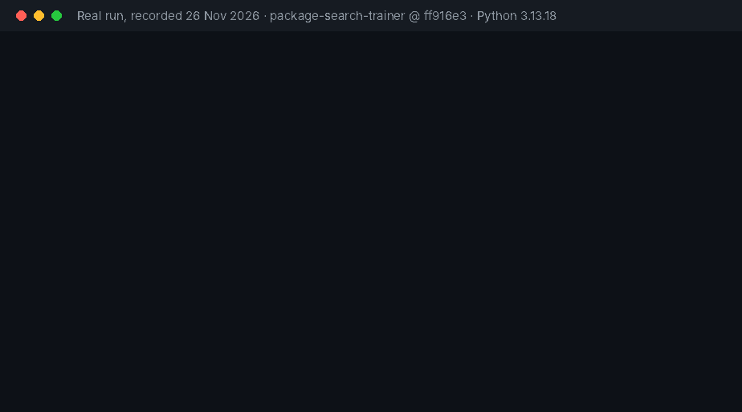

<!-- short-readme -->
<h1 align="center">package-search-trainer</h1>

<p align="center"><b>Crawl pages, pull out fields, chunk the text and train it into search.</b></p>

<p align="center"><a href="#try-it">Try it</a> · <a href="docs/architecture.md">How it works</a> · <a href="docs/usage-and-examples.md">Usage and examples</a> · <a href="docs/troubleshooting.md">Troubleshooting</a> · <a href="docs/reference.md">Full reference</a></p>

<p align="center"><a href="https://github.com/TalkingDB/package-search-trainer/stargazers"></a></p>

<p align="center">
  
</p>
<p align="center"><sub>A real run of the extractor and chunker at <code>ff916e3</code> with Python 3.13.18, 26 Nov 2026; details in <a href="docs/usage-and-examples.md#what-the-extractor-and-chunker-produce">Usage and examples</a>.</sub></p>

Give it URLs or a sitemap and the [CSS selectors](https://developer.mozilla.org/en-US/docs/Web/CSS/CSS_selectors) for the fields you want; it fetches, extracts, splits the text into overlapping chunks and trains them into [package-document-search](https://github.com/TalkingDB/package-document-search).

## What it does

- **Extract** named fields with CSS selectors; a missing one gives an empty field, not a crash ([example](docs/usage-and-examples.md)).
- **Chunk** the main text into overlapping windows.
- **Train** the chunks for vector and keyword search ([how it works](docs/architecture.md)).

## Try it

```bash
make sync MODE=git
poetry install
make test
make local              # API on http://localhost:8095, Swagger at /docs
```

Training needs a working document search (Milvus and an `OPENAI_API_KEY`).

## Where it fits

Writes into [package-document-search](https://github.com/TalkingDB/package-document-search); turning fields into ontology nodes is done with [package-parse-tree](https://github.com/TalkingDB/package-parse-tree).

## Learn more

| Page | Read it to |
| :--- | :--- |
| [How it works](docs/architecture.md) | see the parts and how data moves |
| [Usage and examples](docs/usage-and-examples.md) | copy working examples |
| [Troubleshooting](docs/troubleshooting.md) | fix a problem |
| [Full reference](docs/reference.md) | read everything that used to be on this page |
| [All docs](docs/README.md) | see every page |

## Support TalkingDB

If package-search-trainer saved you time, please [give it a star](https://github.com/TalkingDB/package-search-trainer) ⭐. Stars help other developers find the project.

Found a bug, or a document it gets wrong? [Open an issue](https://github.com/TalkingDB/package-search-trainer/issues/new). We are always here to help and open to a conversation. Explore the TalkingDB applications at [talkingdb.io](https://talkingdb.io/#applications).

## License

> [!NOTE]
> This repository does not have a LICENSE file yet. Most TalkingDB repositories are licensed under [AGPL-3.0](https://www.gnu.org/licenses/agpl-3.0.html); until a LICENSE file is added here, no license is granted by this README.
