# Architecture

[Docs home](README.md) › Architecture

What happens inside one crawl, and the assumptions the pipeline makes. For setup, start at the [README](../README.md).

## One crawl, step by step

<picture>
  <source media="(prefers-color-scheme: dark)" srcset="images/steps-inside-crawl-and-index-dark.svg">
  
</picture>

Diagram source: [steps-inside-crawl-and-index.mmd](diagrams/steps-inside-crawl-and-index.mmd). Edit it and re-render with the steps in [docs/diagrams](diagrams/README.md).

In words: every page is fetched, its fields pulled out, its main text cut into chunks, and the chunks sent to document search twice, once as vectors and once as keyword documents; pages that fail are listed, not fatal. Code: [`services/train/orchestrator.py`](../talkingdb_st/services/train/orchestrator.py).

## File responsibility map

| File | Does |
| :--- | :--- |
| [`services/crawl/fetcher.py`](../talkingdb_st/services/crawl/fetcher.py) | `fetch_page(url)` with `requests`, a 30 second timeout and the user agent `talkingdb-search-trainer/1.0`; raises `FetchError` on any failure |
| [`services/crawl/extractor.py`](../talkingdb_st/services/crawl/extractor.py) | `extract_content(html, selectors)`: each field is the text of every element its selector matches, joined by spaces; no match gives an empty string |
| [`services/crawl/chunker.py`](../talkingdb_st/services/crawl/chunker.py) | `chunk_text(text, chunk_size, overlap)`: word based chunks; `overlap` must be smaller than `chunk_size` |
| [`services/crawl/sitemap.py`](../talkingdb_st/services/crawl/sitemap.py) | `discover_urls_from_sitemap(url)`: every `<loc>` in a plain `urlset` sitemap |
| [`services/train/orchestrator.py`](../talkingdb_st/services/train/orchestrator.py) | `crawl_and_index(...)`: the loop above |
| [`api/crawl.py`](../talkingdb_st/api/crawl.py) | `POST /api/namespaces/{namespace}/crawl` and `POST /api/sitemap/discover` |

## Assumptions to know before you crawl

> [!IMPORTANT]
> The target namespace in package-document-search must already exist, and its Milvus schema is assumed to be exactly two fields, `(id, embedding)`. Other extracted fields go to the keyword index only. A wider vector schema needs the caller to build its own bulk data.

- Chunk IDs are `URL#chunk0`, `URL#chunk1`, and so on. Crawling the same URL again produces the same IDs.
- Vector training receives `[ids, texts]` with `vector_index=1` by default, which is the texts column.
- Nothing is trained when no page produced a chunk.

## Dependencies

As of 25 November 2026 this repository pins `base-tdb-models` at `6ad6e83`, `base-tdb-clients` at `29abea2`, `base-tdb-helpers` at `d7c891b`, `package-parse-tree` at `1ea5b70` and `package-document-search` at `e571768`. It is pinned by [module-ecommerce-ai](https://github.com/TalkingDB/module-ecommerce-ai) at `cfd2b44`, the current head of `main`.

---

**Related:** [Troubleshooting](troubleshooting.md) · [Usage and examples](usage-and-examples.md) · [README](../README.md)
