# package-search-trainer: full reference

[Back to the README](../README.md)

Everything that was on the front page before it was shortened, unchanged apart from links, so nothing is lost.

A generic crawl and train pipeline: it fetches pages from URLs you give it (or from a sitemap), pulls named fields out with CSS selectors, splits the main text into overlapping chunks, and trains those chunks into [package-document-search](https://github.com/TalkingDB/package-document-search) for vector and keyword search.


| Start here | Go deeper |
| :--- | :--- |
| [Where this fits](#where-this-fits) | [Architecture: one crawl, step by step](architecture.md) |
| [Quickstart](#quickstart) | [Usage and examples: selectors, chunks, sitemaps](usage-and-examples.md) |
| [Key terms](#key-terms) | [Troubleshooting](troubleshooting.md) |
| [What this repo is not](#what-this-repo-is-not) | [Client (direct or API mode)](#client) |

All pages: [docs/](README.md).

This package is domain agnostic TalkingDB infrastructure: it has no built in concept of "products", "ecommerce", a WooCommerce connector, or any specific site. Every crawl is set by the caller (URLs, CSS selectors, which field to chunk). Domain crawl configs belong to the `module-*` repository that consumes this package.

## Key terms

| Term | Meaning |
| :--- | :--- |
| **CSS selector** | A pattern that points at part of a web page, such as `h1.entry-title` for the title. See [MDN: CSS selectors](https://developer.mozilla.org/en-US/docs/Web/CSS/CSS_selectors) |
| **Chunk** | A slice of text small enough to embed well. Here a chunk is a fixed number of words |
| **Overlap** | Words repeated at the start of the next chunk, so a sentence cut at a boundary still appears whole in one of them |
| **Sitemap** | An XML file listing a site's pages. See [sitemaps.org](https://www.sitemaps.org/protocol.html) |

## Where this fits

<picture>
  <source media="(prefers-color-scheme: dark)" srcset="images/where-package-search-trainer-fits-dark.svg">
  
</picture>

<sub>Diagram source: [where-package-search-trainer-fits.mmd](diagrams/where-package-search-trainer-fits.mmd). Edit it and re-render with the steps in [docs/diagrams](diagrams/README.md).</sub>

In words: callers hand this service a list of pages and what to pull from them; it fetches, chunks and trains the text into document search. Turning crawled fields into [ontology](https://en.wikipedia.org/wiki/Ontology_(information_science)) nodes is a separate step the caller does with parse-tree.

## Quickstart

You need Python 3.12 or 3.13, [Poetry](https://python-poetry.org/docs/#installation), the `base-tdb-*` repositories plus `package-parse-tree` and `package-document-search` checked out next to this one, and a working document search setup (Milvus and an `OPENAI_API_KEY`) for anything that trains.

```bash
make sync MODE=git      # or MODE=local for editable checkouts
poetry install
make test
make local              # API on http://localhost:8095, Swagger at /docs
```

## Client

`talkingdb_st.client.STClient` gives callers one interface that works two ways, chosen by `CLIENT_MODE` (default `direct`):

- **Direct mode** runs the crawl in process and pushes into package-document-search through a `DSClient` it builds itself. That `DSClient` follows its own `CLIENT_MODE`, so an all in one deployment stays in one process.
- **API mode** calls a deployed package-search-trainer service over HTTP. Set `CLIENT_MODE=api` and `ST_HOST` to its base URL.

## What this repo is not

- **Not a polite crawler by itself.** It does not read `robots.txt`, rate limit, or follow links. It fetches exactly the URLs it is given, with a 30 second timeout each. Only crawl sites you are allowed to crawl.
- **Not a JavaScript renderer.** It reads the HTML the server returns; content drawn by JavaScript after load is not seen.
- **Not an ontology writer.** Structured fields go to the keyword index only. Shaping them into ontology nodes belongs to the caller, with [package-parse-tree](https://github.com/TalkingDB/package-parse-tree).
- **Not a sitemap index walker.** A sitemap of sitemaps is not followed automatically; call discovery once per child sitemap.

## Related repositories

| Repository | Relationship |
| :--- | :--- |
| [package-document-search](https://github.com/TalkingDB/package-document-search) | Where chunks are trained; pinned at `e571768` |
| [package-parse-tree](https://github.com/TalkingDB/package-parse-tree) | Pinned at `1ea5b70`; used by callers for ontology data |
| [module-ecommerce-ai](https://github.com/TalkingDB/module-ecommerce-ai) | Crawls supplementary content such as buying guides through this package |

## Further reading

- [Beautiful Soup: CSS selectors](https://www.crummy.com/software/BeautifulSoup/bs4/doc/#css-selectors)
- [Chunking strategies for retrieval](https://www.pinecone.io/learn/chunking-strategies/)
- [Sitemaps XML format](https://www.sitemaps.org/protocol.html)
