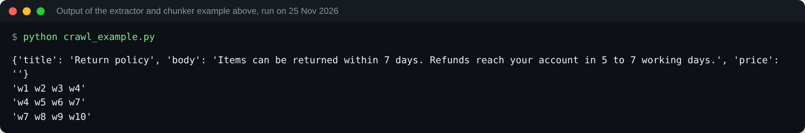

# Usage and examples

[Docs home](README.md) › Usage and examples

```bash
ST=http://localhost:8095
NS=support
```

Create the namespace in [package-document-search](https://github.com/TalkingDB/package-document-search/blob/main/docs/usage-and-examples.md) first, with a two field schema: `id` (string, primary) and `embedding` (vector, 1536 dimensions).

## Find pages from a sitemap

```bash
curl -s -X POST "$ST/api/sitemap/discover" \
  -H "Content-Type: application/json" \
  -d '{"sitemap_url": "https://example.com/sitemap.xml"}'
```

Returns a JSON list of page URLs. A sitemap index is not followed; call this again for each child sitemap.

## Crawl and train

```bash
curl -s -X POST "$ST/api/namespaces/$NS/crawl" \
  -H "Content-Type: application/json" \
  -d '{"urls": ["https://example.com/help/returns", "https://example.com/help/refunds"],
       "selectors": {"title": "h1.entry-title", "body": "div.entry-content"},
       "content_field": "body",
       "chunk_size": 200,
       "overlap": 20}'
```

| Field | Default | Meaning |
| :--- | :--- | :--- |
| `urls` | required | Pages to fetch, exactly as given |
| `selectors` | required | Field name to CSS selector |
| `content_field` | required | Which field to chunk and embed |
| `id_field` | `id` | Name of the ID field in keyword documents |
| `vector_index` | `1` | Which column of `[ids, texts]` to embed |
| `chunk_size`, `overlap` | `200`, `20` | Words per chunk, and words repeated in the next chunk |
| `partition` | none | Train into one partition of the namespace |

The response is `{"pages_crawled": ..., "chunks_indexed": ..., "failures": [{"url": ..., "error": ...}]}`.

## What the extractor and chunker produce

Both functions are plain Python. This was run on 25 November 2026 against commit `cfd2b44`:

```python
from talkingdb_st.services.crawl.extractor import extract_content
from talkingdb_st.services.crawl.chunker import chunk_text

html = """<html><body><h1 class="entry-title">Return policy</h1>
<div class="entry-content"><p>Items can be returned within 7 days.</p><p>Refunds reach your account in 5 to 7 working days.</p></div></body></html>"""

print(extract_content(html, {"title": "h1.entry-title", "body": "div.entry-content", "price": "span.price"}))

words = " ".join(f"w{i}" for i in range(1, 11))
for c in chunk_text(words, chunk_size=4, overlap=1):
    print(repr(c))
```

Output:

```text
{'title': 'Return policy', 'body': 'Items can be returned within 7 days. Refunds reach your account in 5 to 7 working days.', 'price': ''}
'w1 w2 w3 w4'
'w4 w5 w6 w7'
'w7 w8 w9 w10'
```



<sub>Screenshot of the real command and its unedited output, 25 Nov 2026.</sub>

The missing `price` selector gives an empty string instead of an error. With `chunk_size=4` and `overlap=1`, each chunk starts with the last word of the one before.

## Use it as a library

```python
from talkingdb_st.client import STClient

client = STClient()   # CLIENT_MODE=direct by default
result = client.crawl_and_train(
    "support",
    urls=["https://example.com/help/returns"],
    selectors={"title": "h1", "body": "main"},
    content_field="body",
)
```

Set `CLIENT_MODE=api` and `ST_HOST` to call a deployed service instead.

## Choosing chunk size and overlap

Smaller chunks give sharper matches but lose context; bigger chunks keep context but blur what the chunk is about. The defaults (200 words, 20 overlap) are a middle ground for help articles. For a longer discussion, see [Chunking strategies for retrieval](https://www.pinecone.io/learn/chunking-strategies/).

---

**Related:** [Architecture](architecture.md) · [Troubleshooting](troubleshooting.md) · [README](../README.md)
